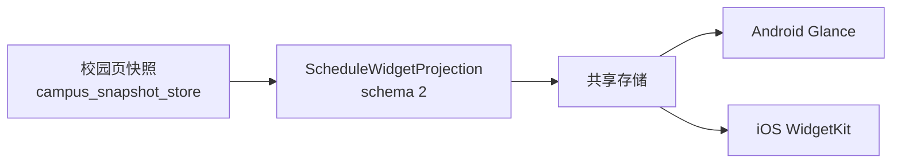

# 桌面小组件

移动端在 Android（Glance）和 iOS（WidgetKit）上提供桌面课表小组件。小组件不联网，渲染所需的数据全部来自 App 提前写入共享存储的本地投影。投影派生自校园快照，快照的结构与淘汰规则见[持久化存储](/development/mobile/persistence)。

下文 `lib/` 开头的路径都相对 `apps/mobile/packages/forum_app/`；各层的完整路径见文末表格。

## 组件清单与平台差异

| 组件 | Android | iOS |
| --- | --- | --- |
| 下一节课（NextClass） | 有，尺寸分档 Compact / WideCompact / Expanded | 有，仅 systemSmall |
| 今日课表（TodaySchedule） | 有，中尺寸今日 + 大尺寸今日/明天双列 | 有，systemMedium / systemLarge；中尺寸在今日课程不多时并排显示明天 |
| 课程时间线（CourseTimeline） | 有，可纵向 resize，带"今天/明天"切换按钮 | 无 |

Android 三个组件是 [GlanceAppWidget](https://developer.android.com/develop/ui/compose/glance)，由 [`NextClassWidgetReceiver`](https://github.com/YourTongji/YourTJ-Hub/blob/dev/apps/mobile/packages/forum_app/android/app/src/main/kotlin/tj/yourtj/forum_app/widget/NextClassWidget.kt) / [`TodayScheduleWidgetReceiver`](https://github.com/YourTongji/YourTJ-Hub/blob/dev/apps/mobile/packages/forum_app/android/app/src/main/kotlin/tj/yourtj/forum_app/widget/TodayScheduleWidget.kt) / [`CourseTimelineWidgetReceiver`](https://github.com/YourTongji/YourTJ-Hub/blob/dev/apps/mobile/packages/forum_app/android/app/src/main/kotlin/tj/yourtj/forum_app/widget/CourseTimelineWidget.kt) 三个 receiver 托管，均继承 vendored home_widget 插件的 `HomeWidgetGlanceWidgetReceiver`。iOS 只有一个 [WidgetBundle](https://developer.apple.com/documentation/widgetkit/widgetbundle)，内含 `NextClassWidget` 和 `TodayScheduleWidget` 两个 [StaticConfiguration](https://developer.apple.com/documentation/widgetkit/staticconfiguration)。

两端的渲染行为有几处刻意不同：

- **已结束课程**：iOS 在展示层过滤——`Day.remaining(at:)` 只保留 `endAt > now` 的课程，已结束课程自动从列表消失；但状态计算走未过滤的完整天，以此区分"今日课程已结束"（finished）和"今天没课"（noClasses）。Android 不过滤全天列表，而是用 `current` 标记高亮正在进行的课程。
- **明天切换**：仅 Android 的 CourseTimeline 有逐组件的"今天/明天"切换（按 appWidgetId 存偏好，删除组件时清理）。iOS 的明天内容只在今日课表组件内附带展示。
- **刷新驱动**：iOS 完全由 WidgetKit 时间线驱动；Android 依赖 Flutter 与 receiver 双方排的闹钟，见下节。
- **可点击区域**：iOS 整个组件可点；Android 只有标题等非列表区域可点，课程项点击无行为（刻意决策，机制见下文「深链契约」）。

## 数据流

- **快照来源**：校园页把 profile / calendar / timetable / today 四类数据以单行原子快照写入 `CampusSnapshotStore`（`lib/src/offline/campus_snapshot_store.dart`）。小组件只消费这份快照的投影，不发起新的学校请求，也不读取排课器 store——小组件上永远是官方课表，不包含用户自建的排课方案。
- **投影生成**：`ScheduleWidgetProjection.fromSnapshot`（`lib/src/campus_widget/schedule_widget_projection.dart`）把快照整理成 schema 2 投影：当日保留服务端权威结果，校历规则可靠时再推算未来七天；时区固定 `Asia/Shanghai`。
- **唯一写入触发点**：`_commitPersistent`（`lib/src/pages/campus/campus_state.dart`）。校园页刷新完成、四个白名单数据集齐全时，先把快照落盘，再拉取校历规则，最后经 `ScheduleWidgetBridge` 写入共享存储。两处失败都有容忍：校历规则拉取失败时保留权威快照、未来天按 unknown 发布；桥写入失败时异常被吞掉，快照本身仍可读。
- **共享存储**：App Group `group.tj.yourtj.forumApp.widgets`（键 `schedule_widget_projection`），是 Flutter 与原生代码之间唯一的交换通道。该标识符仅 iOS 生效，即 [App Groups](https://developer.apple.com/documentation/xcode/configuring-app-groups) 共享容器；Android 侧插件忽略它，数据落在插件固定的 SharedPreferences 文件里。原生两端解析失败一律按无投影处理。

**调度分工**（写入完成后由谁、在什么时刻唤醒组件）：

- Flutter 侧 `updateTimesAfter` 算出候选时刻：八天窗口内全部课程的起止时间、每个自然日的 00:00（上海）、`generatedAt + 7 天`，去重、丢弃已过去的时刻后排序。这组时刻只排给 NextClass 和 TodaySchedule 两个 receiver。
- Android NextClass receiver 在 `onEnabled` / `onUpdate` 时自排一次：取倒计时下一次跨档时刻（5 分钟取整边界，超过 24 小时后改为小时粒度）、下一门课程起止、下一上海午夜、`generatedAt + 7 天` 中最近的一个。
- Android CourseTimeline receiver 只排下一上海午夜，用于"今天"翻页；最后一个组件移除（`onDisabled`）时取消调度。
- iOS 不设闹钟：WidgetKit `getTimeline` 用 `timelineDates(after:)` 生成与 `updateTimesAfter` 同构的时间线条目（课程起止、每日零点、过期点），渲染到条目时刻自动切换。

Android manifest 注册了 `HomeWidgetScheduledUpdateReceiver` 并监听 `BOOT_COMPLETED`，重启后闹钟恢复；未申请 `SCHEDULE_EXACT_ALARM`。

## 投影 schema（schema 2）

`schemaVersion` 为 2，时区恒为 `Asia/Shanghai`，两端解析时版本或时区不匹配即拒绝。`days` 是八天窗口（今天 + 未来 7 天）：`days[0]` 是服务端权威结果（`source: server-adjusted`），其余每天在校历规则可靠时为 `local-resolved`（由校历规则与学期课表本地推算，含调课、补课、节假日），规则不可用时为 `unknown`——unknown 天照常发布，组件显示"需要更新课表"而不是编造内容。`generatedAt` 距今严格大于 7 天即视为过期（stale）。

各端仍保留 schema 1 读路径：读 `today` 对象加 `schoolDate` 与 `semester.week`，三端（Dart 模型、Kotlin 解析器、Swift 解码器）一致，旧数据可直接迁移。

顶层字段的读取方如下（`toJson` 写出的每个字段都列出）：

| 字段 | 读者 |
| --- | --- |
| `schemaVersion` / `timezone` | 两端解析时校验，不匹配拒绝 |
| `identity.siteKey` / `accountScope` / `bindingRevision` | 两端解析时校验非空后即丢弃，见下节 |
| `generatedAt` | 两端读（过期判断、"更新于"） |
| `schoolDate` | schema 1 读路径消费（Kotlin / Swift 的 v1 回退） |
| `semester.id` | 目前只有写入端，无读取方 |
| `semester.week` | schema 1 读路径消费 |
| `sectionTimes` | 目前只有写入端，无读取方（课程起止已带具体时间） |
| `days[].date` / `week` / `source` / `kind` / `adjustmentLabel` / `courses` | 三端读 |
| `days[].holiday` | 派生标记（`kind == "holiday"` 的冗余写出），目前无读取方 |

`days[].courses[]` 每门课：`stableId`（对课程特征做 sha256 取前 16 位，调课日带源日期做种子，保证同一门课改期后 id 仍稳定）、`name`、`teacher`、`room`、`campus`、`startSection` / `endSection`、`startAt` / `endAt`（上海时区 ISO 串）、`colorSlot`（1–8，由 Dart 侧 `courseColorSlotFor(name)` 按课程名稳定分配）。Android 侧 8 个槽位对应 `widget_colors.xml` 的色值资源，iOS 侧 8 个槽位在 Swift 里以硬编码 RGB 数组镜像 web 端 `tokens.css` 的 `--gf-color-course-1..8`。

## 生命周期与隐私

**身份字段不做比对**。投影里的 `identity` 三个字段是写入端对站点、账号作用域、绑定版本做的 sha256 前 16 位不透明化；两端原生解析后只校验非空即丢弃，不与当前账号比较。跨账号隔离不靠它，靠清除流程。

**清除入口与终态**。`ScheduleWidgetBridge.clear(state:)` 删除投影和临时键、写入终态到 `schedule_widget_empty_state`、取消 NextClass 与 TodaySchedule 的闹钟并触发一次刷新。终态有四个，各自有专属文案（两端一致）：

| 终态 | 触发入口 |
| --- | --- |
| `signedOut` | 登出、401 会话失效、重新登录进入登录页：`clearOfflineCache` / `clearOfflineCacheQuietly`（`lib/src/providers.dart`） |
| `unbound` | 校园页发现未绑定：`_clearPersistent`（`lib/src/pages/campus/campus_state.dart`） |
| `authorizationRequired` | 校园页发现绑定需要重新授权：同上 |
| `needsData` | 默认终态；设置页"清除校园缓存"（`lib/src/pages/settings/campus_cache_clear_tile.dart` 的 `clearCampusDeviceCache`）与校园页其余清除路径 |

写入流程有两层保护：

- **两段式落盘**：先写临时键 `schedule_widget_projection_pending`，读回并完整反序列化校验后才提升为正式键、清掉临时键，同时把 `empty_state` 置为 `ready`；写一半被杀进程不会留下半份数据。读到 `ready` 但无投影时两端都按"需要更新课表"渲染。
- **代际隔离**：桥内 `generation` 计数器在 `clear` 或缓存 epoch 变化时递增；`write` 入队记下代际，执行时与最新代际比对，作废旧账号排队中的写入。

背景透明度也在 App 内设置，范围 0–15%（默认 9%），写入同一共享存储（键 `schedule_widget_transparency_percent`），写入后触发组件刷新。

## 深链契约

组件点击经深链回 App：

- **构造方**：Android 在组件表面点击时以 `HOME_WIDGET_LAUNCH_ACTION` 启动 `ThemeRouterActivity`，URI 为 `yourtj://campus/today`。iOS 两个组件的 `widgetURL` 均为 `yourtj://campus/today?homeWidget=true`。
- **转发方**：iOS vendored home_widget 插件的 scene 回调只转发带 `homeWidget` 查询参数的链接，其余深链不走小组件通道。Android 插件以 launch action 识别组件点击。
- **消费方**：`scheduleWidgetLinkProvider`（`lib/src/providers.dart`）把链接流交给 `lib/src/app.dart`，只校验 `scheme == yourtj` 且 `host == campus`，然后 `go('/campus')`。

点击是**组件级**行为：Android 课程列表区域内的触摸被 [LazyColumn](https://developer.android.com/reference/kotlin/androidx/glance/appwidget/lazy/LazyColumn) 消费，不触发跳转；只有标题等非列表区域响应点击。若未来需要"点课程聚焦"，正确入口是给 `LazyColumn` 的 item 各自加 `clickable` 并在 URI 上重新引入课程标识参数——不要把列表区域的静默当作 bug 修掉。

## 守护测试

小组件契约由两层测试守护，改动任一层都会先于真机暴露问题：

- `test/campus_widget_test.dart`：Dart 逻辑单测（9 组），用内存数据库与假仓库跑真实代码。覆盖：快照的原子写入、作用域隔离、损坏 schema 丢弃；投影最小化（编码结果不含姓名、token、cookie、学号、邮箱、成绩、消息）与状态机（upcoming / inClass / break / finished / noClasses / holiday / needsRefresh / stale）；八天窗口内服务端今日权威、未来天本地推算、节假日与调课规则；11 / 12 节时间回退；schema 1 读路径与可选文本清洗；网络失败时保留最后一份快照与投影；绑定版本变化时清掉旧快照与小组件；校历规则失败仍发布 unknown 未来天。
- `test/native_widget_structure_test.dart`：原生结构与数值契约断言（17 组），直接读源文件与工程文件做字符串/正则断言。覆盖：Glance 组件纯本地渲染（无 `java.net` / `OkHttp`，iOS 无 `URLSession`）与无障碍语义；manifest 的 receiver 注册、`BOOT_COMPLETED`、不申请 `SCHEDULE_EXACT_ALARM`；三个 widget 的尺寸、resize 模式与选择器预览资源；大型课表双等宽列与独立滚动结构；NextClass 尺寸分档与倒计时自排；CourseTimeline 的今天/明天切换与 receiver 接线；iOS WidgetBundle 构成、App Group 双端 entitlements、部署目标（Runner 13.0 / 扩展 14.0）；iOS 课程色与 web `tokens.css` 做数值换算比对；字号下限与截断策略；vendored home_widget 插件的 iOS 13 兼容行为（iOS 13 上 reload 为 no-op，保证登录清理能完成）；深链必须带 `homeWidget=true` 标记；debug 配置与开发 APK 的 ABI splits。

## 各层位置

| 层 | 位置 |
| --- | --- |
| Flutter 桥接 | [schedule_widget_bridge.dart](https://github.com/YourTongji/YourTJ-Hub/blob/dev/apps/mobile/packages/forum_app/lib/src/campus_widget/schedule_widget_bridge.dart) |
| 投影模型 | [schedule_widget_projection.dart](https://github.com/YourTongji/YourTJ-Hub/blob/dev/apps/mobile/packages/forum_app/lib/src/campus_widget/schedule_widget_projection.dart) |
| 写入触发 | [campus_state.dart](https://github.com/YourTongji/YourTJ-Hub/blob/dev/apps/mobile/packages/forum_app/lib/src/pages/campus/campus_state.dart) |
| 深链消费 | [app.dart](https://github.com/YourTongji/YourTJ-Hub/blob/dev/apps/mobile/packages/forum_app/lib/src/app.dart)、[providers.dart](https://github.com/YourTongji/YourTJ-Hub/blob/dev/apps/mobile/packages/forum_app/lib/src/providers.dart) |
| Android 基类与组件表面 | [ScheduleGlanceWidget.kt](https://github.com/YourTongji/YourTJ-Hub/blob/dev/apps/mobile/packages/forum_app/android/app/src/main/kotlin/tj/yourtj/forum_app/widget/ScheduleGlanceWidget.kt) |
| Android 共享 UI | [ScheduleWidgetCommon.kt](https://github.com/YourTongji/YourTJ-Hub/blob/dev/apps/mobile/packages/forum_app/android/app/src/main/kotlin/tj/yourtj/forum_app/widget/ScheduleWidgetCommon.kt) |
| Android 下一节课 | [NextClassWidget.kt](https://github.com/YourTongji/YourTJ-Hub/blob/dev/apps/mobile/packages/forum_app/android/app/src/main/kotlin/tj/yourtj/forum_app/widget/NextClassWidget.kt)（含 receiver） |
| Android 今日课表 | [TodayScheduleWidget.kt](https://github.com/YourTongji/YourTJ-Hub/blob/dev/apps/mobile/packages/forum_app/android/app/src/main/kotlin/tj/yourtj/forum_app/widget/TodayScheduleWidget.kt)（含 receiver） |
| Android 课程时间线 | [CourseTimelineWidget.kt](https://github.com/YourTongji/YourTJ-Hub/blob/dev/apps/mobile/packages/forum_app/android/app/src/main/kotlin/tj/yourtj/forum_app/widget/CourseTimelineWidget.kt)（含 receiver 与日期切换 action） |
| Android 解析 | [ScheduleWidgetData.kt](https://github.com/YourTongji/YourTJ-Hub/blob/dev/apps/mobile/packages/forum_app/android/app/src/main/kotlin/tj/yourtj/forum_app/widget/ScheduleWidgetData.kt) |
| iOS WidgetKit | [ScheduleWidgets.swift](https://github.com/YourTongji/YourTJ-Hub/blob/dev/apps/mobile/packages/forum_app/ios/ScheduleWidgets/ScheduleWidgets.swift) |
| iOS 解析 | [ScheduleProjection.swift](https://github.com/YourTongji/YourTJ-Hub/blob/dev/apps/mobile/packages/forum_app/ios/ScheduleWidgets/ScheduleProjection.swift) |
| home_widget 插件 | [third_party/home_widget/](https://github.com/YourTongji/YourTJ-Hub/tree/dev/apps/mobile/third_party/home_widget/)（仓库内 vendor，非 pub 依赖） |
| Dart 逻辑测试 | [campus_widget_test.dart](https://github.com/YourTongji/YourTJ-Hub/blob/dev/apps/mobile/packages/forum_app/test/campus_widget_test.dart) |
| 原生契约测试 | [native_widget_structure_test.dart](https://github.com/YourTongji/YourTJ-Hub/blob/dev/apps/mobile/packages/forum_app/test/native_widget_structure_test.dart) |
