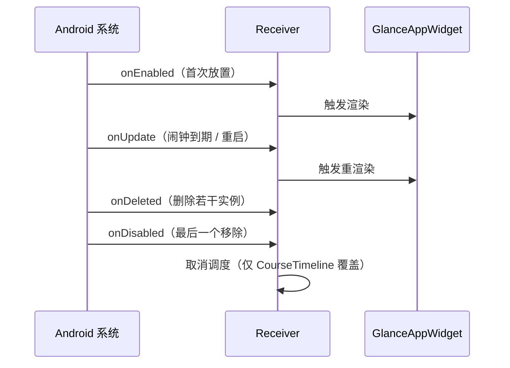

# Android Receiver 详解

Receiver 是 Android 小组件的生命周期入口：组件的放置、更新、删除由系统以广播形式通知到它。它不渲染 UI（渲染是 `GlanceAppWidget` 的事），职责是"什么时候该更新、更新前做什么准备"。自排调度统一建立在插件的 [HomeWidgetScheduler](https://github.com/YourTongji/YourTJ-Hub/blob/dev/apps/mobile/third_party/home_widget/android/src/main/kotlin/es/antonborri/home_widget/HomeWidgetScheduler.kt) 之上：按 receiver 类名存一份待触发时刻表，到期发广播触发 `onUpdate`。

数据从哪来、谁负责渲染见[概览](/development/mobile/widgets/)。

系统按组件实例的生命周期调用四个钩子：

| 钩子 | 触发时机 |
| --- | --- |
| `onEnabled` | 该组件类型第一次在桌面被放置 |
| `onUpdate` | 需要刷新：首次放置后、闹钟到点、重启恢复 |
| `onDeleted` | 删除了一个或多个实例（参数带被删实例的 appWidgetId 数组） |
| `onDisabled` | 最后一个实例被移除，组件彻底退出桌面 |

## NextClassWidgetReceiver

代码在 [NextClassWidget.kt](https://github.com/YourTongji/YourTJ-Hub/blob/dev/apps/mobile/packages/forum_app/android/app/src/main/kotlin/tj/yourtj/forum_app/widget/NextClassWidget.kt) 末尾。三个 receiver 里唯一自己精算刷新时刻的：

- `onEnabled` 与 `onUpdate` 都调 `scheduleNextUpdate`：读共享存储里的投影，经 `nextUpdateAt(now)` 从四类候选时刻中取最近的一个——倒计时文案的下次翻页（5 分钟取整边界，剩余超过 24 小时后改为小时粒度）、八天窗口内下一门课程的起止、下一上海午夜、`generatedAt + 7 天` 的投影过期点。
- 取到的时刻交给 `HomeWidgetScheduler.schedule` 排一个闹钟，到期触发 `onUpdate` 重渲染。
- 为什么这层自排必要：倒计时翻页点依赖渲染侧状态机的结果，Flutter 的 `updateTimesAfter` 算不出来（它只排课程起止、午夜、过期点）。分工是 Flutter 排粗粒度时刻，receiver 补细粒度翻页。
- 投影不存在时直接不排（无时刻可算），组件渲染空态即可。

## TodayScheduleWidgetReceiver

代码在 [TodayScheduleWidget.kt](https://github.com/YourTongji/YourTJ-Hub/blob/dev/apps/mobile/packages/forum_app/android/app/src/main/kotlin/tj/yourtj/forum_app/widget/TodayScheduleWidget.kt) 末尾。纯宿主：除 `override val glanceAppWidget` 外没有任何 override，生命周期全走基类默认实现。它的更新完全来自 Flutter——`updateTimesAfter` 排的课程起止、午夜、过期点已覆盖"今日课表"需要的全部刷新时机，没有需要原生侧补算的细粒度时刻。这个 receiver 说明自排不是必须的：只有渲染内容依赖 Flutter 算不出的时刻时才需要。

## CourseTimelineWidgetReceiver

代码在 [CourseTimelineWidget.kt](https://github.com/YourTongji/YourTJ-Hub/blob/dev/apps/mobile/packages/forum_app/android/app/src/main/kotlin/tj/yourtj/forum_app/widget/CourseTimelineWidget.kt) 末尾。生命周期钩子覆盖最全的一个：

- `onEnabled` / `onUpdate` → `scheduleNextDay`：只排下一上海午夜，到点"今天"翻成"明天"。
- `onDeleted`：清理被删实例的"显示明天"偏好（按 appWidgetId 存取），组件删了偏好不残留。
- `onDisabled`：`HomeWidgetScheduler.cancel` 取消调度，最后一个组件移除后不再空转。

同一文件里的切换按钮走 [ActionCallback](https://developer.android.com/reference/kotlin/androidx/glance/appwidget/action/ActionCallback)（`ToggleCourseTimelineDayAction`），链路是：点击 → 把 `glanceId` 换成 `appWidgetId` → 翻转该实例的偏好 → `updateAppWidgetState` 同步插件状态 → `widget.update` 立即重渲染。

iOS 侧没有 receiver 概念：WidgetKit 由系统统一调度，组件无需关心生命周期钩子。
