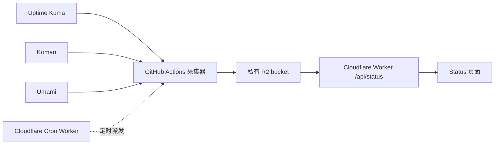

# 运行状态站

`apps/status` 是独立于论坛部署的 Vue / Vite 应用，通过 Cloudflare Workers 提供服务，目标地址为 `status.yourtj.de`。

状态站用于在论坛故障时继续提供服务状态。它不读取论坛 Cookie，也不调用论坛 API。

## 数据从哪里来

| 来源 | 展示内容 |
| --- | --- |
| Uptime Kuma | 可用性、检测结果、响应时间 |
| Komari | CPU、内存、磁盘、网络、运行时长 |
| Umami | 访客、浏览量、访问次数等公开统计 |
| 移动端设备上报 | 访客的设备类型、操作系统和浏览器分布 |

浏览器不会直接访问这些上游。

GitHub Actions 采集器负责采集允许公开的字段，把结果写入私有 R2 bucket；Cloudflare Worker 只读取快照，通过 `/api/status` 返回给页面。Worker 没有采集路由，访客的任何请求都不会触发新的上游采集。



上游 URL、共享 token 和原始响应不会交给浏览器。

## 为什么使用快照

如果每个访客打开页面都直接请求三套上游，状态页会把用户流量放大成监控流量，而且某个上游变慢时会拖慢整页。

采集分两类，由独立的 Cloudflare Cron Worker 按 UTC 定时向 GitHub Actions 工作流发起派发：

- 公共资源（当前资源、可用性、历史曲线、访问统计）：每 15 分钟。
- 移动端设备上报：每小时。

GitHub 自带的定时任务是备用调度，启用独立调度器后停用。浏览器每 60 秒读取一次已经生成的快照，不触发新的上游采集。

## 过期数据怎么显示

状态站保留原始采集时间，不会因为浏览器刚刷新页面就把旧数据变成"实时"。

当前资源、可用性、历史和流量超过 20 分钟视为过期，超过 1 小时后隐藏；设备上报超过 70 分钟视为过期，超过 3 小时后隐藏。单个来源失败时，最近成功数据可以短暂保留，但会明确显示为过期。

页面会把缺少新数据标记为过期，不会显示成"服务正常"。

## 部署到 Cloudflare

部署使用 Wrangler，需要 Node 24 和 pnpm 11。生产环境通过 Custom Domain 绑定 `status.yourtj.de`，预览环境和生产环境使用独立的私有 R2 bucket（`yourtj-status-preview` 和 `yourtj-status`）。

`apps/status` 提供三个部署脚本：

| 脚本 | 用途 |
| --- | --- |
| `pnpm deploy:preview` | 部署预览 Worker 到 `yourtj-status-preview` |
| `pnpm deploy:production` | 部署生产 Worker，绑定 `status.yourtj.de` |
| `pnpm deploy:scheduler` | 只部署独立的 Cron 调度 Worker |

调度 Worker 没有任何公开 URL 和 R2 binding，只负责定时向采集工作流发起派发，凭据以 secret 形式保存在 Worker 上。

生产发布由 `Deploy / status` 工作流从 `main` 分支执行。手动补采也在 GitHub Actions 上进行，选择 `Collect / status` 工作流的 `workflow_dispatch`，采集类型选 `public` 或 `devices`：

```bash
gh workflow run collect-status.yml --repo YourTongji/YourTJ-Hub --ref main -f kind=public
# 设备来源单独运行：
gh workflow run collect-status.yml --repo YourTongji/YourTJ-Hub --ref main -f kind=devices
```

Worker 还代理 `/mobile/releases.json`，这是移动端发布说明资产的只读代理，不经过 R2。

## 本地验证

```bash
cd apps/status
pnpm install --frozen-lockfile
pnpm test
pnpm build
pnpm test:browser
```

本地验证需要 Node 24 或更高版本。本地构建通过只说明应用本身可运行。上线还要检查 Worker、R2 bucket、DNS、HTTPS 和定时采集是否真正工作。
